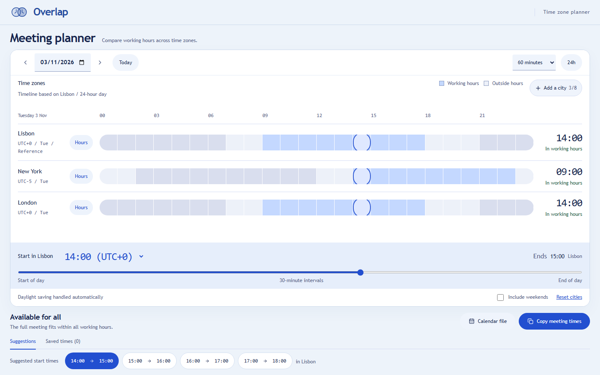

# Overlap

Find a meeting time across cities, compare working hours, and save a few options. Copy local times or download a calendar invite with the meeting name and city details.

[Try it](https://jpndmatos.github.io/overlap/)



## Setup

Node.js 22.14+.

```sh
npm ci
npm run dev
```

Open http://localhost:5176. Cities and saved times stay in your browser. Time zones account for daylight-saving changes.

React · TypeScript · Intl. [Development notes](docs/development.md).
