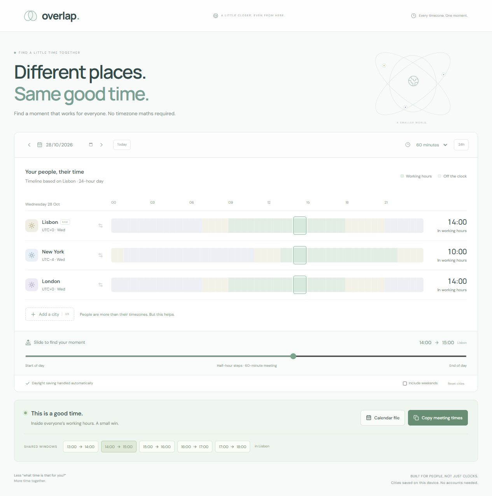

# Overlap

Different places. Same good time. A small meeting planner for finding a moment that works across timezones.

[Try the live demo](https://jpndmatos.github.io/overlap/)



## What it does

- Start with Lisbon, New York, and London, or search for other cities and IANA timezones.
- Compare up to eight locations on a shared timeline.
- Pick a date, a 30/60/90/120-minute duration, and a start time in half-hour steps.
- Set working hours for each city, including overnight hours; optionally include weekends.
- Find windows where the entire meeting fits in everyone's working hours.
- Copy local meeting times or download an `.ics` calendar file.
- Remember your city list and working hours on this device.
- Display each city's local time above its timeline on small screens.

## Run locally

Node.js 22.14+ and npm (Node 24 recommended).

```sh
npm ci
npm run dev
```

Open **http://127.0.0.1:5176**.

```sh
npm test           # DST, quarter-hour offsets, weekends, overnight hours
npm run build     # type-check and build to dist/
npm run preview   # preview the production build
```

The production app is static. `base: './'` supports repository-path hosting. The GitHub Pages workflow tests and builds before deploying.

## Time, properly

React, TypeScript, Vite, and native `Intl.DateTimeFormat`. IANA timezone identifiers drive local dates and UTC offsets, rather than hard-coded timezone differences. The first city is the reference for the selected calendar day. A daylight-saving transition can produce a 23- or 25-hour timeline. Availability checks each 15-minute segment of the complete meeting.

Tests cover Lisbon's spring and autumn DST changes, Kathmandu's 45-minute offset, the weeks when US and European DST schedules differ, weekend exclusions, overnight working hours, and meetings that overrun closing time.

## Scope

This version compares working hours, not live calendar availability. It has no calendar account connection, invitations, holiday calendars, or backend. Downloading an `.ics` file does not book or send anything; add attendees in your calendar app. Local timezone accuracy depends on the browser's timezone database. Selected dates and meeting settings reset on reload; city preferences are kept in localStorage.

No analytics or accounts. DM Sans and Manrope are loaded from Google Fonts. Icons by Lucide.

Built by [João Matos](https://github.com/jpndmatos). MIT licensed.
