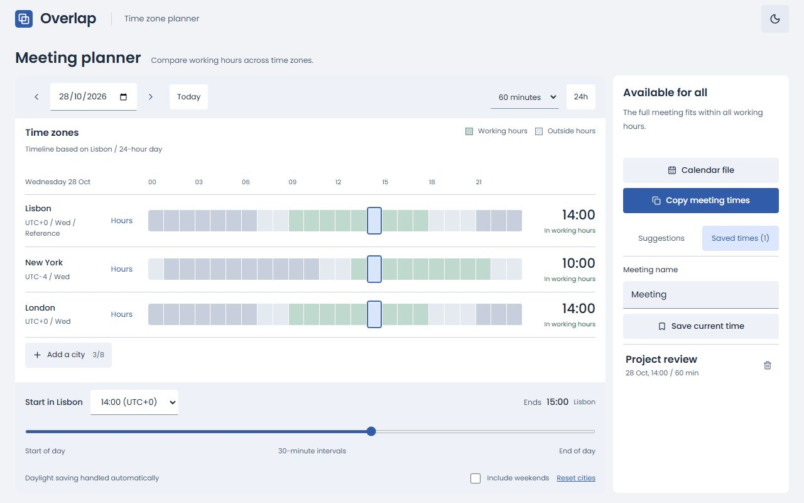
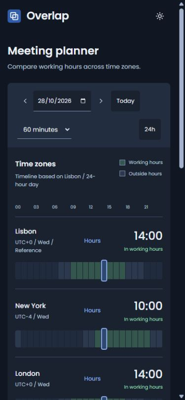

# Overlap

A time zone planner for arranging meetings. Add cities, compare working hours, and choose a meeting time. You can copy the details or save a calendar file.

[Open Overlap](https://jpndmatos.github.io/overlap/)

<picture>
  <source media="(prefers-color-scheme: dark)" srcset="docs/dark-dashboard.jpg">
  
</picture>

<details>
  <summary>Mobile view</summary>
  <br>
  
</details>

## Features

- Search cities and compare up to eight time zones.
- Set working hours, a meeting date, start time, and duration.
- Find shared availability with daylight-saving adjustments.
- Switch the reference city and view each location's local time.
- Copy meeting times or download an ICS file.
- Six named meeting-time bookmarks, saved city preferences, and light and dark themes.

The desktop dashboard keeps the timeline and meeting options together, with long city lists contained inside the timeline panel.

## Stack

React, TypeScript, Vite, and the Intl API.

## Run locally

Requires Node.js 22.14 or later.

```sh
npm ci
npm run dev
```

Open [localhost:5176](http://localhost:5176).

```sh
npm test
npm run build
npm run preview
```
