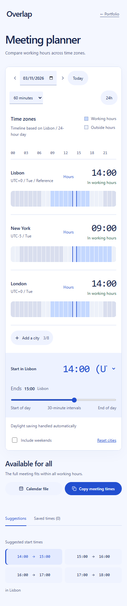

# Overlap


A time zone planner for arranging meetings. Add cities, compare working hours, and choose a meeting time. You can copy the details or save a calendar file.


[Open Overlap](https://jpndmatos.github.io/overlap/)


<details>

  <summary>Mobile view</summary>

  <br>

  

</details>


## Features


- Search cities and compare up to eight time zones.
- Keep the same meeting instant when changing or removing the reference city.

- Set working hours, a meeting date, start time, and duration.

- Find shared availability with daylight-saving adjustments.

- Switch the reference city and view each location's local time.

- Copy meeting times or download an ICS file.

- Six named meeting-time bookmarks, saved city preferences.


## Stack


React, TypeScript, Vite, and the Intl API.


## Run locally


Requires Node.js 22.14 or later.


```sh

npm ci

npm run dev

```


Open [localhost:5176](http://localhost:5176).


```sh

npm test

npm run build

npm run preview

```


## Implementation notes


The selected meeting is stored as an instant, then formatted in each city’s IANA time zone. Changing the reference city preserves that instant. Daylight-saving days can contain 23 or 25 hours; saved meetings and calendar exports use the same time helpers.


## Verification


The app fills the viewport, with longer lists scrolling inside their panels. On phones, Timeline and Meeting options keep each work area usable without squeezing the controls. Layout checks cover 320×568 through 1440×900.


The production build and unit tests pass. Portfolio integration checks cover the main workflows at 390px and 1440px, WCAG A/AA checks including WCAG 2.2 target sizes, and failure handling. The mobile Lighthouse lab result is saved in `docs/performance.json`; it is a local observation, not a field-performance guarantee.


## Browser workflow checks

`npm run test:browser` exercises the production build at desktop, phone and landscape sizes, including WCAG checks. CI starts the application and uses an isolated browser context for each size. Set `PLAYWRIGHT_CHANNEL=chrome` to use installed Chrome, or install Playwright Chromium with `npx playwright install chromium`.
